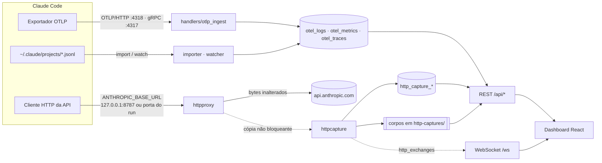
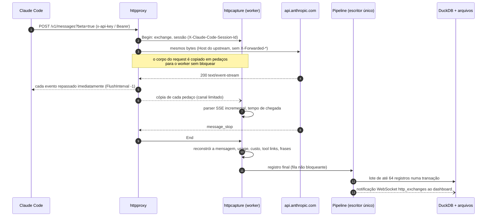
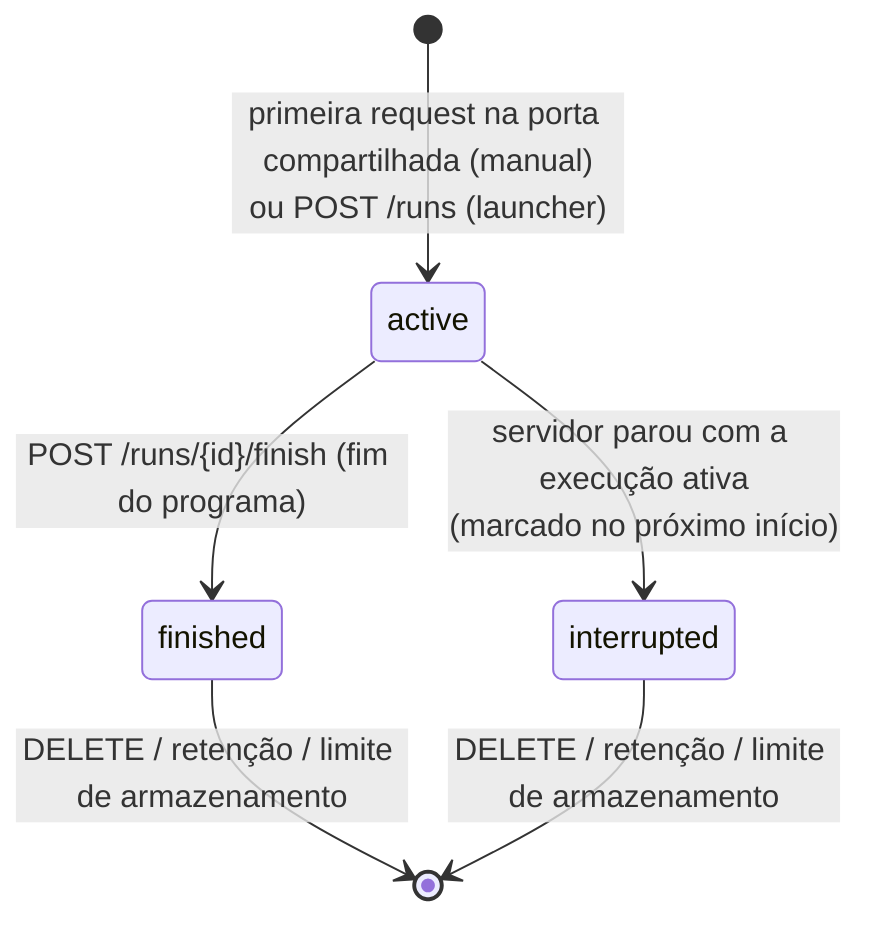

# HTTP Inspector — arquitetura

O HTTP Inspector acrescenta ao AI Observer uma **terceira fonte** de dados do
Claude Code, ao lado do OTLP e dos arquivos de sessão (JSONL). As três
fontes ficam em tabelas separadas e são **comparadas**, nunca somadas.

## Três fontes, três caminhos

- **OTLP** descreve o que o Claude Code *diz* sobre suas chamadas (eventos
  `api_request`, métricas de tokens e custo). Não contém os corpos HTTP.
- **JSONL** é o histórico local de mensagens, gravado pelo cliente.
- **HTTP Inspector** é o que passou **no fio**: requests e responses
  completos, cada evento SSE com tempo de chegada, `count_tokens`,
  chamadas auxiliares e erros.

## Pacotes

| Pacote | Papel |
|---|---|
| `internal/anthropicwire` | Parser puro do protocolo: classificação de endpoint, parser SSE incremental, reconstrução da mensagem, `usage` (cumulativo), resumo do request (`system`, `tools`, `messages`, breakpoints de cache, sessão), `tool_use`/`tool_result`, frases didáticas, Context Diff, decodificação gzip/deflate/br/zstd |
| `internal/httpproxy` | Reverse proxy (`httputil.ReverseProxy`) com upstream fixo validado, listener compartilhado e um listener por execução do launcher |
| `internal/httpcapture` | Observação não bloqueante dos corpos, worker por exchange, saneamento, gravação dos corpos, custo, vínculo de ferramentas e pipeline de escrita |
| `internal/storage/http_capture_*.go` | Tabelas, escrita em lotes e consultas |
| `internal/handlers/http_inspector.go` | API REST `/api/http-inspector/*` e `/api/sessions/{id}/http-exchanges` |
| `cmd/server/cmd_run.go` | `ai-observer run -- claude` |
| `cmd/fake-anthropic` | Upstream simulado para demonstrações e testes sem chave |

## Caminho de uma request

### Por que o tráfego nunca espera a captura

1. O proxy repassa os bytes ao cliente **antes** de entregá-los à captura.
2. A cópia para a captura é `select` com `default`: se o canal do exchange
   (512 pedaços) ou o orçamento global de memória (`BufferBytes`) estiver
   cheio, o pedaço é **descartado**, a parte é marcada como perdida e o
   exchange como `degraded`.
3. A gravação no banco é feita por um único goroutine com fila limitada
   (`AI_OBSERVER_HTTP_CAPTURE_QUEUE_SIZE`); fila cheia descarta o registro
   e conta em `droppedRecords` (self-metrics e `/api/http-inspector/status`).
4. Falhas de banco ou de disco viram `storeErrors` / `capture_degraded`,
   nunca erro para o cliente.

## Execuções (runs)

- **manual**: a porta compartilhada (`8787`). Uma execução por processo do
  servidor, criada na primeira request.
- **launcher**: cada `ai-observer run` recebe um listener `127.0.0.1:0`
  exclusivo; requests de execuções paralelas nunca se misturam.

## Sessões

A sessão de cada exchange vem, em ordem:

1. do cabeçalho `X-Claude-Code-Session-Id` (`header:X-Claude-Code-Session-Id`);
2. de `metadata.user_id` do corpo (`body:metadata.user_id`), que no Claude
   Code 2.1.x é uma string JSON `{"device_id":…,"account_uuid":…,"session_id":…}`
   e, em versões antigas, `user_<hex>_account_<uuid>_session_<uuid>`.

O ID é o mesmo que o OTLP (`session.id`) e os arquivos JSONL usam, por isso
a aba "Tráfego da API" aparece na sessão já existente. A evidência usada é
gravada e mostrada na interface.

## Deduplicação entre fontes

- Tabelas separadas: `http_capture_*` não entram em `/api/stats`, nas
  séries de métricas, em `usage_summary` nem nos totais das sessões.
- `GET /api/sessions/{id}/http-exchanges` traz `comparison`: as requests do
  proxy são casadas com os eventos `api_request` do OTLP pelo `request_id`
  (cabeçalho `request-id` da resposta). O resultado diz quantas casaram e a
  certeza (`exact`, `partial`, `none`), com notas — os valores são
  mostrados lado a lado, **não somados**.
- Uso e custo do proxy têm `source: http_proxy`.

## Context Diff

Para cada request de inferência, a base de comparação é, em ordem:

1. a request anterior da **mesma conversa** (mesmo hash da primeira
   mensagem, calculado sem os `cache_control`, que o Claude Code move para a
   mensagem mais nova a cada chamada);
2. a anterior do mesmo modelo;
3. a anterior da sessão.

O diff mostra prefixo comum, mensagens adicionadas/substituídas, novos
`tool_result`, parâmetros alterados, hashes de `system` e `tools`,
ferramentas adicionadas/removidas e breakpoints de cache.

## Versões

- Testado com **Claude Code 2.1.331** (`claude-cli/2.1.331`) contra o
  upstream simulado, com chave fictícia (ver [TESTING.md](TESTING.md)).
- Esquema: tabelas novas no schema base (`CREATE ... IF NOT EXISTS`); a
  versão de schema do upstream não mudou, então o banco continua abrindo
  no AI Observer original (que apenas ignora as tabelas novas).

Decisões detalhadas: [adr/](adr/).
