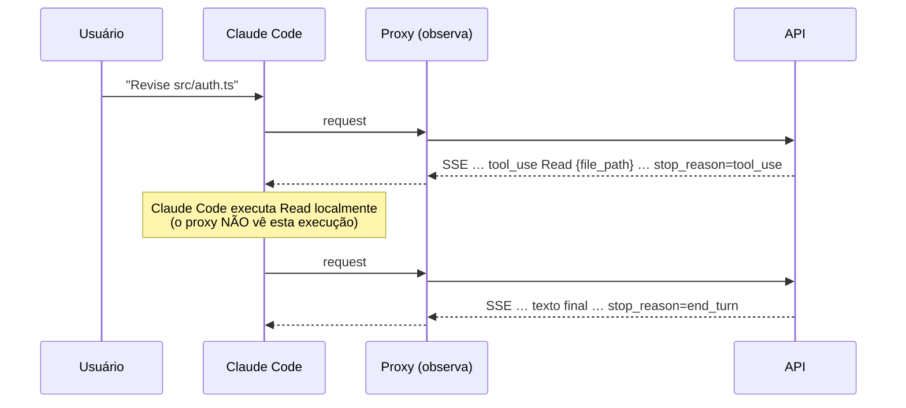

# HTTP Inspector — o protocolo no fio

Exemplo realista, **saneado e encurtado**, do que o Claude Code troca com a
API da Anthropic numa tarefa que usa uma ferramenta. As formas (nomes de
campos, cabeçalhos, sequência de eventos) foram conferidas com o Claude Code
**2.1.331** passando pelo proxy até o upstream simulado
(`cmd/fake-anthropic`); valores, IDs e textos são fictícios.

Referências: [Messages API](https://platform.claude.com/docs/en/api/messages),
[Streaming](https://platform.claude.com/docs/en/build-with-claude/streaming),
[Prompt caching](https://platform.claude.com/docs/en/build-with-claude/prompt-caching),
[Count tokens](https://platform.claude.com/docs/en/api/http/messages/count_tokens).

## 1. Request de inferência

```http
POST /v1/messages?beta=true HTTP/1.1
Host: api.anthropic.com
Content-Type: application/json
Accept: application/json
Accept-Encoding: gzip, deflate, br, zstd
Anthropic-Version: 2023-06-01
Anthropic-Beta: claude-code-20250219,interleaved-thinking-2025-05-14,…
User-Agent: claude-cli/2.1.331 (external, sdk-cli)
X-Api-Key: [REDACTED]                       ← nunca gravado (ou Authorization: Bearer …)
X-App: cli
X-Claude-Code-Session-Id: c858fbff-3c96-495d-a3bb-4626bff2ac60
X-Stainless-Retry-Count: 0
```

```json
{
  "model": "claude-sonnet-4-5-20250929",
  "max_tokens": 32000,
  "stream": true,
  "system": [
    {"type": "text", "text": "You are Claude Code, …"},
    {"type": "text", "text": "…instruções, ambiente, CLAUDE.md…", "cache_control": {"type": "ephemeral"}}
  ],
  "tools": [
    {"name": "Read", "description": "Reads a file…", "input_schema": {"type": "object", "properties": {"file_path": {"type": "string"}}}},
    {"name": "Bash", "…": "…"},
    {"name": "mcp__exemplo__busca", "defer_loading": true, "…": "…"}
  ],
  "messages": [
    {"role": "user", "content": [
      {"type": "text", "text": "Revise o arquivo src/auth.ts e aponte um problema de segurança",
       "cache_control": {"type": "ephemeral"}}
    ]}
  ],
  "metadata": {"user_id": "{\"device_id\":\"…\",\"account_uuid\":\"…\",\"session_id\":\"c858fbff-…\"}"},
  "thinking": {"type": "adaptive"},
  "context_management": {"…": "…"}
}
```

O que o inspector extrai: `system` (3 blocos, 29 KB, hash), `tools` (12
definições, 47 KB, 1 com `defer_loading` — tool search ativo mesmo com
`ANTHROPIC_BASE_URL`), mensagens por papel e tipo de bloco, breakpoints de
`cache_control` com a localização (`system[1]`,
`messages[0].content[0]`), parâmetros e campos desconhecidos (preservados,
listados como `unknownFields`).

## 2. Response em streaming (SSE)

```text
event: message_start
data: {"type":"message_start","message":{"id":"msg_…","model":"claude-sonnet-4-5-20250929","content":[],"stop_reason":null,
       "usage":{"input_tokens":24,"cache_creation_input_tokens":3000,"cache_read_input_tokens":0,
                "cache_creation":{"ephemeral_5m_input_tokens":3000,"ephemeral_1h_input_tokens":0},"output_tokens":1}}}

event: ping
data: {"type":"ping"}

event: content_block_start
data: {"type":"content_block_start","index":0,"content_block":{"type":"text","text":""}}

event: content_block_delta
data: {"type":"content_block_delta","index":0,"delta":{"type":"text_delta","text":"Vou ler o arquivo de autenticação."}}

event: content_block_stop
data: {"type":"content_block_stop","index":0}

event: content_block_start
data: {"type":"content_block_start","index":1,"content_block":{"type":"tool_use","id":"toolu_01…","name":"Read","input":{}}}

event: content_block_delta
data: {"type":"content_block_delta","index":1,"delta":{"type":"input_json_delta","partial_json":"{\"file_path\":\"/home/"}}

event: content_block_delta
data: {"type":"content_block_delta","index":1,"delta":{"type":"input_json_delta","partial_json":"aluno/demo/src/auth.ts\"}"}}

event: content_block_stop
data: {"type":"content_block_stop","index":1}

event: message_delta
data: {"type":"message_delta","delta":{"stop_reason":"tool_use","stop_sequence":null},"usage":{"output_tokens":48}}

event: message_stop
data: {"type":"message_stop"}
```

Reconstrução:

- o texto e o JSON da ferramenta são a concatenação dos deltas de cada
  `index`; o JSON parcial só é interpretado no `content_block_stop`;
- `thinking` só aparece se a API o **transmitir** (`thinking_delta`,
  `signature_delta`); o inspector nunca o inventa;
- `stop_reason: tool_use` → o modelo **pediu** uma ferramenta; isso não
  prova que ela foi executada.

Cada evento é gravado com `offset_ms` (chegada relativa ao início do
request), tamanho, tipo e status do parse. Um stream sem `message_stop` vira
estado `partial` com uso `partial`.

## 3. Tokens e cache

`usage` é **cumulativo** em streaming: `message_start` traz input e cache,
cada `message_delta` traz o `output_tokens` acumulado. O valor final é o
último observado, nunca a soma:

| Evento | `output_tokens` visto |
|---|---|
| `message_start` | 1 |
| `message_delta` | 48 |
| **final** | **48** (não 49) |

Totais derivados:

```
total_input     = input_tokens + cache_read_input_tokens + cache_creation_input_tokens
                = 24 + 0 + 3000 = 3024
total_processed = total_input + output_tokens = 3072
```

Divisão da escrita de cache: `cache_creation.ephemeral_5m_input_tokens` e
`ephemeral_1h_input_tokens`; sem a divisão, todo `cache_creation_input_tokens`
é `unknown`.

Custo equivalente de API (catálogo de preços do AI Observer, por milhão de
tokens): `input × preço_input + output × preço_output + cache_read ×
preço_cache_read + cache_write_5m × preço_cache_write`. A escrita de 1 h não
tem preço no catálogo: o custo fica `partial` e o motivo é mostrado. Um
modelo fora do catálogo dá custo `unavailable`, nunca `$0`.

## 4. Fluxo de ferramenta



O request #2 carrega:

```json
{"role": "assistant", "content": [
  {"type": "text", "text": "Vou ler o arquivo de autenticação."},
  {"type": "tool_use", "id": "toolu_01…", "name": "Read", "input": {"file_path": "/home/aluno/demo/src/auth.ts"}}
]},
{"role": "user", "content": [
  {"type": "tool_result", "tool_use_id": "toolu_01…",
   "content": "1\t// Projeto fictício…\n…", "cache_control": {"type": "ephemeral"}}
]}
```

O vínculo `tool_use.id = tool_result.tool_use_id` (na mesma execução) liga o
exchange #1 ao #2 como `matched`. O `cache_control` mudou de lugar: está
agora na mensagem mais nova. Por isso o Context Diff compara mensagens sem
os `cache_control` — o prefixo comum continua sendo a primeira mensagem.

Na resposta do request #2, o uso mostra o efeito do cache:

```json
{"input_tokens": 180, "cache_read_input_tokens": 3000, "cache_creation_input_tokens": 420,
 "cache_creation": {"ephemeral_5m_input_tokens": 420, "ephemeral_1h_input_tokens": 0}, "output_tokens": 37}
```

## 5. `count_tokens`

```http
POST /v1/messages/count_tokens?beta=true
```

```json
{"input_tokens": 1234}
```

Aparece na timeline como `token_count` ("esta chamada apenas contabilizou
tokens"). O valor é uma **estimativa** e fica em `count_tokens`, separado:
não entra em input/output de inferência nem em custo.

## 6. Erros

Resposta JSON (`status ≥ 400`):

```json
{"type": "error", "error": {"type": "overloaded_error", "message": "Overloaded"},
 "request_id": "req_…"}
```

Ou, no meio de um stream:

```text
event: error
data: {"type":"error","error":{"type":"overloaded_error","message":"Overloaded"}}
```

Ambos são repassados intactos ao cliente; o inspector mostra o status,
`error_type`, a mensagem e o estado do exchange. Falhas do próprio proxy
(upstream inalcançável, timeout) respondem `502`/`504` no mesmo formato de
erro da Anthropic (`type: api_error`), e o exchange fica
`failed`.

## 7. Outras chamadas

Qualquer outro caminho da API (por exemplo `/v1/models`) é encaminhado e
registrado como `other_api`. Nada é filtrado da timeline por padrão.
